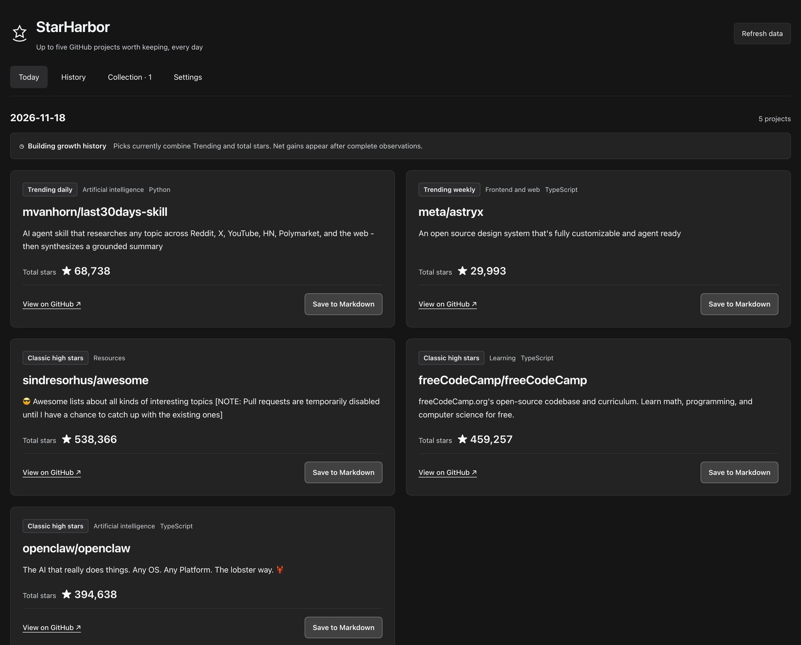

# StarHarbor

[简体中文](README.zh-CN.md)

StarHarbor is a DSH sidebar plugin that recommends up to five public GitHub repositories each day. Browse the daily board, revisit previous boards, and save selected projects to a categorized Markdown collection on your computer.

Each card shows the repository description, total stars, recommendation source, and observed net star gains when the required history exists. The interface follows DSH’s Chinese or English language setting. English displays the repository’s original description; Chinese uses a translation when available and keeps the original when translation fails.

## Screenshots



Captured from the installed v0.2.0 interface and cropped to exclude DSH’s sidebar and private information.

[Chinese interface screenshot](docs/images/today-zh.png)

## Install and get started

Requires DSH `>=0.2.2-rc.1 <0.3.0` and Node.js 22 or later. StarHarbor uses native ESM, has no third-party runtime dependencies, and runs no installation scripts.

The source is [Richology/dsh-starharbor](https://github.com/Richology/dsh-starharbor). Install the tagged GitHub source through DSH’s plugin manager or CLI:

```sh
dsh plugin --profile <profile-name> add github:Richology/dsh-starharbor#v0.2.0
```

For local development, install a checkout instead:

```sh
dsh plugin --profile <profile-name> add /absolute/path/to/dsh-starharbor
```

The npm package has not been published. The [v0.2.0 release](https://github.com/Richology/dsh-starharbor/releases/tag/v0.2.0) includes a prepacked `dsh-starharbor-0.2.0.tgz` attachment. GitHub source installation is the default documented route. Community market inclusion is pending.

After installation:

1. Follow any restart instruction shown by DSH.
2. Open StarHarbor from the star-and-harbor icon in the sidebar.
3. Click **Refresh data** if there is no board yet. Initial collection needs network access.
4. Open a repository on GitHub or click **Save to Markdown**. That card shows progress and then a check mark when saving completes.
5. Open **Collection** or **Settings** to see and copy the actual collection file path.

Saving is explicit; recommendations are never automatically added to your collection. **History** keeps previous daily boards. Settings control star thresholds, the repeat interval, and the daily generation hour.

## Recommendation rules

The target is one daily pick, one weekly pick, and three classics. Fewer than five can appear when there are not enough eligible candidates.

| Slot | Default minimum total stars | Selection rule |
| --- | --- | --- |
| Daily: 1 | 5,000 | Rank observed candidates by the previous complete calendar day’s net star gain when endpoints exist; otherwise use GitHub Trending’s daily order |
| Weekly: 1 | 10,000 | Rank observed candidates by net star gain over seven complete calendar days when all daily endpoints exist; otherwise use GitHub Trending’s weekly order |
| Classics: 3 | 30,000; prefer 50,000 | Prefer the higher threshold, then total stars; prefer different purpose categories |

Candidates come from GitHub Trending’s daily and weekly pages and a high-star GitHub repository search. Each collection round verifies at most 20 additional Trending repositories beyond those returned by the search. Rankings describe this collected candidate pool; they do not establish a winner across all of GitHub. Trending order is not a measurement of calendar-day net star growth.

Forks, archived repositories, saved projects, and repositories in the repeat cooldown are excluded. Saved projects remain excluded while their saved state is retained. Unsaved recommendations have a default 30-day cooldown. A repository appears only once on a daily board. Purpose categories use stable category IDs and local classification rules; programming language alone does not determine the category. Classification can be imperfect.

The default generation time is **09:00 Asia/Shanghai (Beijing time, UTC+8)**. DSH must be running to collect data. When DSH is opened after the generation hour, StarHarbor attempts to generate today’s board; it does not reconstruct missed days. A completed daily board stays stable, including after **Refresh data**. Settings apply to the next board generation.

All settings are integers. Star thresholds accept `0–1,000,000,000`; cooldown accepts `0–3,650` days; generation hour accepts `0–23`. The preferred classic threshold must be at least the classic minimum. Lowering a threshold does not expand the upstream search into an exhaustive GitHub scan.

### What growth figures mean

StarHarbor stores total-star observations near midnight in Asia/Shanghai. Net growth includes unstars and can be negative. Yesterday’s gain requires both calendar-day endpoints. Seven-day gain requires eight endpoints covering seven consecutive complete days.

The accepted endpoint window is midnight **±5 minutes**. These are approximate boundary observations, not an exact record at midnight. DSH being closed, network failures, API limits, or a repository missing from the collected candidates can leave gaps. Missing growth is unknown and is omitted, rather than displayed as zero. A fresh installation usually starts with Trending-based recommendations while observation history accumulates.

### Repository descriptions

The displayed text comes from the public GitHub repository `description`. In Chinese, StarHarbor can translate that description through DSH’s available Google or Bing translation service; translation failure preserves the original text. English uses the original description, which may itself be in any language. The text is a repository description, not a generated assessment or a summary made from the first two README sentences.

## Privacy, network, and local data

By default, data is stored in `StarHarbor/` under **DSH’s default working directory**. In a standard desktop setup this is the DSH default workspace location; changing a chat’s workspace does not move this directory. The interface shows the resolved collection path so you can find the actual file.

| Local file | Contents |
| --- | --- |
| `GitHub收藏.md` | Selected repositories grouped by purpose, with GitHub links, descriptions, and the star count recorded at selection time |
| `state.json` | Settings, daily boards, saved state, observations, and collection errors |

You can add your own notes to the Markdown collection. StarHarbor preserves existing text and uses GitHub’s numeric repository ID to avoid duplicate entries after a rename. The v0.2.0 state migration accepts older JSON data without rewriting existing Markdown headings or notes. Do not manually edit `state.json` while DSH is running. Back up both files to preserve the collection and the state used for exclusions and observations.

To override the directory, set an absolute `dataDir` in the plugin configuration or set `STARHARBOR_DIR` before starting DSH. Configuration takes precedence over the environment variable. The directory is shared by the plugin instance, independently of the active chat.

Network requests go to GitHub Trending and the GitHub REST API for public repository metadata. Only the public GitHub description is sent for translation through DSH’s available Google or Bing provider. StarHarbor does not collect your GitHub starred-repository list or send your local Markdown notes for translation. It uses DSH’s authenticated connection for sidebar operations.

Unauthenticated GitHub REST access is typically limited to 60 requests per IP per hour. To increase the API allowance, optionally set `GITHUB_TOKEN` in the environment before starting DSH. StarHarbor attaches it only to GitHub API requests and does not write it to its state or collection. Never include tokens in issues, screenshots, or the repository. Translation availability and network access depend on your DSH configuration and provider connectivity.

## FAQ and feedback

**Why are there fewer than five projects?**

The star thresholds, candidate availability, exclusions, and cooldown may leave too few eligible repositories. StarHarbor shows the available projects and an explanation. Network or API failures can also limit collection; inspect the displayed error and retry time.

**Why are yesterday’s or weekly gains missing?**

A complete set of midnight observations is required. Keeping DSH open across midnight can help collect future endpoints. Missing historical observations cannot be recovered simply by refreshing.

**Why did refreshing not change today’s projects?**

Daily selection is stable. Refreshing collects source data and updates error information without reshuffling a completed board.

**Why is some Chinese-page text still in the repository’s language?**

Descriptions retain the original when translation is unavailable or fails. Repository names and original descriptions are public source text.

**Where did my collection go after switching chat workspaces?**

It stays under the configured data directory or DSH’s default working directory. Use the collection path shown in StarHarbor instead of assuming it follows the active chat folder.

Report bugs and suggestions in [GitHub Issues](https://github.com/Richology/dsh-starharbor/issues). Include DSH and StarHarbor versions, interface language, reproduction steps, and any visible error. Remove tokens, personal paths, local notes, and private sidebar content before attaching logs or screenshots.

## Development and tests

Clone the repository and use Node.js 22 or later:

```sh
npm run check
npm test
npm pack --dry-run
```

DSH supplies React at runtime. The sidebar and `starharbor` agent tool share the same local application logic. The tool exposes exactly four actions: `status`, `refresh`, `save`, and `settings`. `save` accepts the numeric repository ID from an existing recommendation; `refresh` does not change a completed daily selection. Tool output limits history to the last seven boards and saved entries to the last 50, with total counts; this does not truncate the local files.

Tests use fixtures for recommendation ordering, cooldown, boundary observations, persistence, failure recovery, and duplicate-safe collection. See [CONTRIBUTING.md](CONTRIBUTING.md) for contribution and release checks and [CHANGELOG.md](CHANGELOG.md) for version notes.

Released under the [MIT license](LICENSE).
