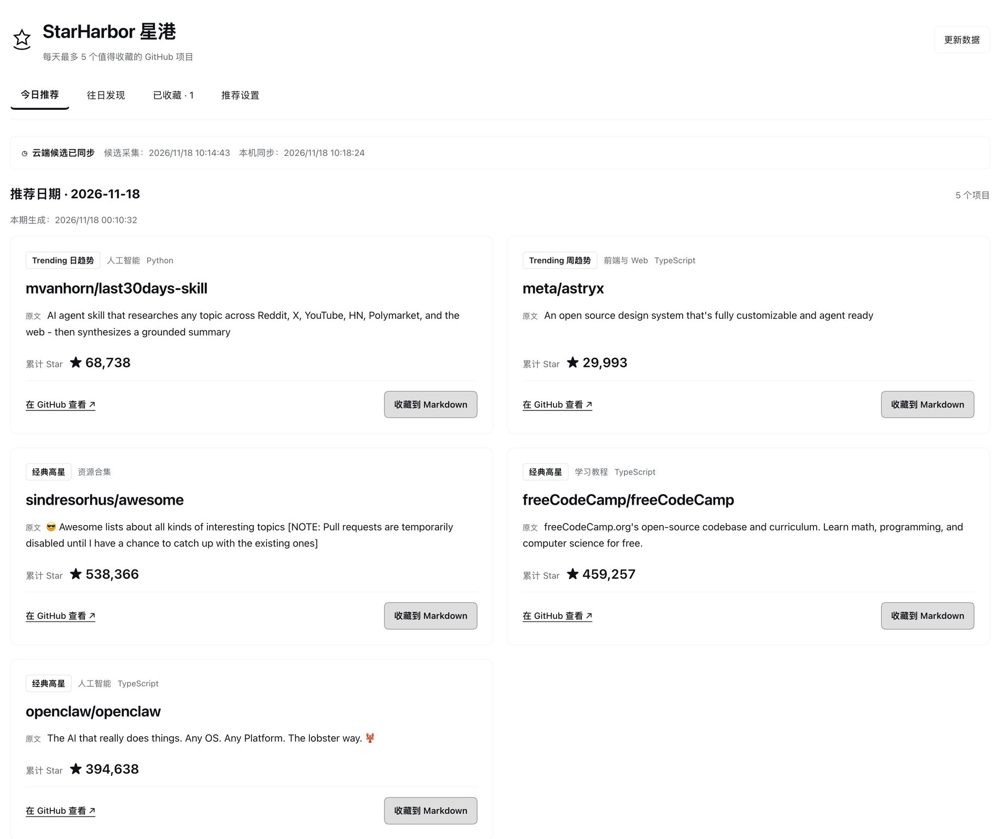

# StarHarbor 星港

[English](README.md)

StarHarbor 星港是 DSH 的侧边栏插件，每天推荐最多 5 个公开 GitHub 仓库。你可以浏览今日推荐、回看往日记录，再把选中的项目保存到电脑上的分类 Markdown 收藏中。

公开候选由 GitHub Actions 统一采集，DSH 关闭时也会继续。插件下载公开数据源，再结合你的门槛、收藏和推荐历史，在本地选出榜单。收藏、历史和设置保留在你的电脑上。

卡片显示仓库原始描述、累计 Star、推荐来源，以及观测完整时计算的净增 Star。界面跟随 DSH 的中英文设置。云端模式不发送翻译请求，仓库描述保留原文。

## 界面截图



截图来自已安装的 v0.3.0 真实界面，拍摄于成功同步线上公开候选数据之后，已裁掉 DSH 侧栏和私人信息。

[查看英文界面截图](docs/images/today-en.png)

## 安装与开始使用

需要 DSH `>=0.2.2-rc.1 <0.3.0` 和 Node.js 22 或更高版本。插件使用原生 ESM 和固定版本的 Undici HTTP 客户端，不运行安装脚本。公开数据请求遵循 HTTP_PROXY/HTTPS_PROXY/ALL_PROXY 及 NO_PROXY 环境变量，小写同名变量优先；macOS 未设置显式代理环境变量时，会读取手动 HTTP/HTTPS 系统代理及绕过规则。纯 PAC 或纯 SOCKS 系统配置暂不自动解析，可通过 HTTP 代理环境变量配置。代理配置只在本机使用，不上传，也不修改系统设置或 Node 全局网络。

通过固定版本的 GitHub 源码安装：

```sh
dsh plugin --profile <你的配置名> add github:Richology/dsh-starharbor#v0.3.2
```

也可以从 [v0.3.2 Release](https://github.com/Richology/dsh-starharbor/releases/tag/v0.3.2) 下载 [dsh-starharbor-0.3.2.tgz](https://github.com/Richology/dsh-starharbor/releases/download/v0.3.2/dsh-starharbor-0.3.2.tgz)，再安装下载的文件：

```sh
dsh plugin --profile <你的配置名> add /absolute/path/to/dsh-starharbor-0.3.2.tgz
```

源码位于 [Richology/dsh-starharbor](https://github.com/Richology/dsh-starharbor)。npm 包尚未发布，社区市场尚未收录。

安装后：

1. 如果 DSH 提示重启，按提示重启。
2. 点击侧边栏的星形港湾图标。插件启动和面板打开时会检查是否到达每小时同步间隔。
3. 点击「更新数据」可立即同步。尚未到设定生成小时，也可以提前生成第一份榜单；已完成的同日榜单保持固定。
4. 打开 GitHub 查看仓库，或点击「收藏到 Markdown」。保存期间该卡片显示处理状态，完成后显示勾选标记。
5. 在「已收藏」或「推荐设置」查看并复制实际收藏文件路径。

只有点击收藏才会写入收藏文件，推荐不会自动收藏。「往日发现」保留此前生成的每日推荐。设置可调整 Star 门槛、重复推荐间隔和每日生成小时。

## 推荐规则

每天目标为日推荐 1 个、周推荐 1 个、经典项目 3 个。符合条件的候选不足时，实际数量可以少于 5 个。

| 名额 | 默认累计 Star 门槛 | 选择依据 |
| --- | --- | --- |
| 日推荐 1 个 | 5,000 | 有完整观测时，按昨日完整自然日净增排序；否则按 GitHub Trending 近 1 日顺序 |
| 周推荐 1 个 | 10,000 | 有完整观测时，按最近 7 个完整自然日净增排序；否则按 GitHub Trending 近 7 日顺序 |
| 经典项目 3 个 | 30,000，优先 50,000 | 优先达到偏好门槛，再按累计 Star 排序，并优先选择不同用途分类 |

云端采集器结合 GitHub Trending 近 1 日、近 7 日页面和 2 至 3 页高 Star 仓库搜索结果，每轮最多额外核实 50 个搜索结果之外的 Trending 仓库。排名仅覆盖已采集候选，不能证明是全 GitHub 冠军。Trending 顺序也不等于完整自然日的净增 Star 排名。本地调低门槛不会扩充公开候选池。

云端排除 fork 和归档仓库。本地选榜时排除已收藏项目和冷却期内的推荐。同一榜单不重复仓库。只要本地收藏状态保留，已收藏项目就长期排除；未收藏项目默认 30 天内不重复推荐。用途分类采用稳定分类 ID 和规则，不单独以编程语言决定分类；分类结果可能有误。

默认在**北京时间 09:00（Asia/Shanghai，UTC+8）**生成本地榜单。DSH 运行时每小时检查云端数据，已有榜单也会继续同步；启动或打开面板时，到期即可同步。到达设定小时后，可直接使用已缓存的当日数据生成榜单，不必等待下一次下载。不补造错过日期的本地榜单。手动「更新数据」会跳过每小时检查间隔，也可提前生成榜单，但不会重选同一数据日期已完成的榜单。新设置从下一次选榜开始生效。

所有设置均为整数。Star 门槛范围为 `0–1,000,000,000`；重复推荐间隔为 `0–3,650` 天；生成小时为 `0–23`。经典项目优先门槛不得低于经典项目最低门槛。

### 数据新鲜度与失败处理

界面区分数据新鲜、过期和不可用，并显示数据日期及更新时间。只有数据日期等于上海当前日期，且生成时间距今不超过 36 小时，才算新鲜。刚下载到的旧日期数据仍然过期。

旧数据不会改名为「今天的推荐」。已有榜单时保留原榜单；尚无榜单而旧数据仍可用时，可以按原日期展示，并标明过期。下载失败、格式错误或非法未来时间戳不会清空上次有效缓存、榜单、收藏和设置。首次下载失败不会固定一份空榜单。可查看界面错误后再次同步。

### 净增 Star 的含义

云端采集器在北京时间午夜附近观测累计 Star。净增包含取消 Star，因此可能为负数。昨日净增需要自然日两端的观测；近 7 日净增需要覆盖连续 7 个完整自然日的 8 个端点。

每个仓库的实际观测时间必须处于午夜**前后 5 分钟**。这是近似边界采样，不是零误差的午夜记录。GitHub Actions 延迟、网络故障、API 限流或仓库未进入候选池都会造成缺失。缺失净增表示未知，界面省略对应数值，不以 0 替代。无需让自己的 DSH 跨午夜运行：观测历史由云端公开数据积累。新数据源在积累足够端点之前可能使用 Trending 排序。

### 仓库描述

卡片文字来自 GitHub 仓库公开的 `description`。云端模式不请求翻译，也不抓取 README 生成摘要。因此，中英文界面均保留仓库原始描述，原文本身可能是任何语言。原文含中文字符时，也可直接填入中文摘要字段；这是原始文字，不是翻译或生成的评估。

## 隐私、网络与本地数据

默认数据源为 [data 分支公开的 latest.json](https://raw.githubusercontent.com/Richology/dsh-starharbor/data/latest.json)，包含公开仓库元数据、排名、观测区间和来源警告。公开午夜观测另存于 [snapshots.json](https://raw.githubusercontent.com/Richology/dsh-starharbor/data/snapshots.json)。两者都不含用户收藏、本地历史或偏好。

默认云端模式下载该数据源时不携带 GitHub token 或 Cookie，不直接访问 GitHub Trending 或 GitHub API，不回退到本机采集，也不发送翻译请求。本地无需配置 `GITHUB_TOKEN`。点击仓库链接时，浏览器照常打开 GitHub。侧边栏操作使用 DSH 已认证的本地连接。

若需切换公开数据源，可配置插件的 `feedUrl`，或在启动 DSH 前设置 `STARHARBOR_FEED_URL`；插件配置优先。请使用可信且格式兼容的数据源。这些设置仅更换来源，不改变本地存储位置。

默认本地目录为 **DSH 默认工作目录**下的 `StarHarbor/`。切换聊天工作目录不会移动它，请以界面显示的真实收藏路径为准。

| 本地文件 | 内容 |
| --- | --- |
| `GitHub收藏.md` | 按用途分类的已收藏仓库，包含 GitHub 链接、描述和推荐时记录的 Star 数 |
| `state.json` | 本地设置、每日榜单、收藏状态、已验证数据缓存、同步状态，以及兼容保留的旧状态 |

已有收藏和历史继续可读。可以在 Markdown 收藏里添加笔记：插件保留已有文字、标题和用户笔记，并使用数字仓库 ID 避免改名后重复收录。升级不批量重写 Markdown。DSH 运行时请勿手动编辑 `state.json`。备份时同时保留两个文件，才能保留收藏内容和本地排除状态。

可通过插件配置的绝对路径 `dataDir`，或启动 DSH 前设置环境变量 `STARHARBOR_DIR`，覆盖默认目录；插件配置优先。目录由插件实例共享，不随当前聊天改变。

## 云端运行

维护者的 GitHub Actions 工作流将公开候选数据以 `latest.json` 和 `snapshots.json` 发布到公开的 `data` 分支，并附上一份简短的生成说明。计划时间为**北京时间每日 00:02、04:17、08:17、12:17、16:17、20:17**。UTC cron 为 `2 16 * * *` 和 `17 0,4,8,12,20 * * *`；其中 UTC 20:17 对应上海次日 04:17。

公开仓库使用标准 GitHub 托管 Linux runner 的计算[免费](https://docs.github.com/en/billing/concepts/product-billing/github-actions)。GitHub [不保证定时任务准点启动](https://docs.github.com/en/actions/reference/workflows-and-actions/events-that-trigger-workflows#schedule)：任务可能延迟或丢弃，公开仓库连续 60 天没有活动时，计划任务还可能自动停用。午夜任务若延迟到采样窗口外，不会被当作有效午夜端点。界面新鲜度和净增可用性以实际结果为准。维护者设置及手动恢复命令见 [CONTRIBUTING.md](CONTRIBUTING.md)。

## 常见问题与反馈

**为什么不足 5 个项目？**

候选数量、Star 门槛、收藏排除和冷却期可能使符合条件的仓库不足。插件显示实际项目和警告。本地调整门槛不会额外请求云端候选。

**为什么没有净增 Star？**

需要完整的云端午夜观测。采集任务延迟或失败可能导致缺失；本地刷新不能补回缺失的历史端点。

**为什么更新数据后，当天项目没有变化？**

同一数据日期的榜单固定。刷新更新公开候选缓存、新鲜度和错误信息，保留已完成的选榜结果；新候选池可用于下一天。

**为什么中文界面仍有其他语言？**

仓库描述保留原文。云端模式不调用翻译服务。

**切换聊天工作区后，收藏在哪里？**

仍在配置的数据目录，或 DSH 默认工作目录下。请查看 StarHarbor 显示的收藏路径。

请通过 [GitHub Issues](https://github.com/Richology/dsh-starharbor/issues) 反馈问题或建议。提供 DSH 和 StarHarbor 版本、界面语言、复现步骤、数据日期与状态、可见错误。上传日志或截图前，请移除 token、个人路径、本地笔记和私人侧栏内容。

## 开发与测试

使用 Node.js 22 或更高版本执行：

```sh
npm run check
npm test
npm pack --dry-run
```

React 由 DSH 在运行时提供。侧边栏与 `starharbor` 对话工具共用本地应用逻辑。四个动作仍为 `status`、`refresh`、`save`、`settings`。`status` 只读，不联网；`refresh` 同步候选，`force: true` 跳过每小时检查间隔；`save` 使用已有推荐的数字仓库 ID。工具返回最近 7 个历史榜单、最近 50 个收藏和总数，不因此截断本地文件。

测试覆盖数据验证、新鲜度、超时、取消、本地选榜、隐私、冷却、持久化、失败恢复和收藏去重。底层 `createHarbor` API 为旧调用者和测试保留省略 `feedUrl` 时的直接采集行为；安装后的插件界面不提供此模式。贡献说明见 [CONTRIBUTING.md](CONTRIBUTING.md)，版本变化见 [CHANGELOG.md](CHANGELOG.md)。

项目采用 [MIT 许可证](LICENSE)。
